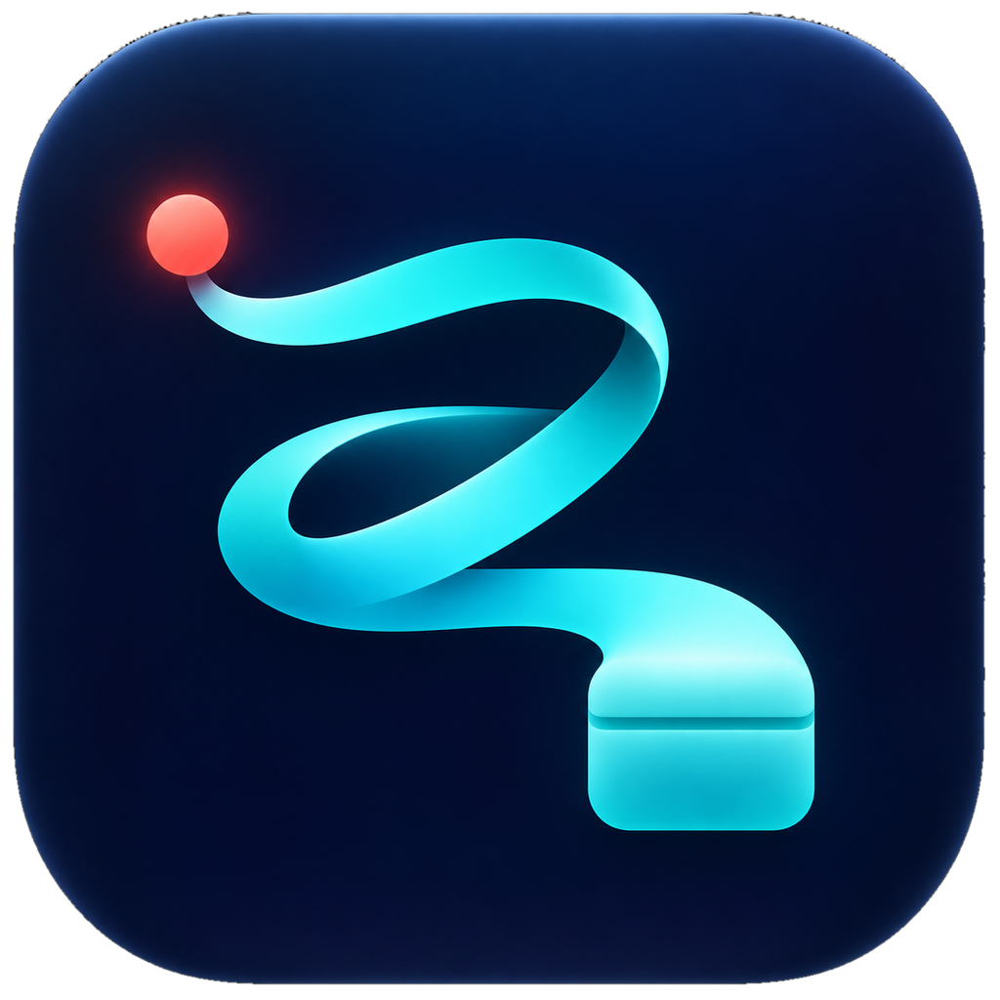

# Reprise

A macOS menu bar app that records YouTube premieres for you. Reprise watches the
premiere, captures the LIVE broadcast from the very first moment and then fetches the
final VOD, in the best quality YouTube offers.
`Première → Live → Reprise`.



## Version 1.6.75

New in this version: a redesigned main window with **Scheduled**, **Incoming** and
**Recordings**, a clear card for the next premiere with the steps
Verified → Monitoring → Capture LIVE → Save VOD, and confirmation of exactly which VOD
version was downloaded: resolution, codec and frame rate, in the app and in the push
notification. Also fixed: a dark band that could cover the page title.

Apple Silicon, macOS 14 or later. The app is signed locally and not notarized by Apple.
Reprise uses [yt-dlp](https://github.com/yt-dlp/yt-dlp) and ffmpeg; you install those
separately.

## Installation

Download `Reprise.zip` from [Releases](https://github.com/reprise-labs/reprise/releases).

1. Install yt-dlp and ffmpeg with [Homebrew](https://brew.sh): `brew install yt-dlp ffmpeg`.
2. Unzip the file and move `Reprise.app` to your Applications folder.
3. Open Reprise the first time with **right-click → Open**. Because the app isn't
   notarized, a plain double-click refuses to open it; right-click shows an *Open* button.

After that, updates arrive automatically through [Sparkle](https://sparkle-project.org):
Reprise checks daily, shows the release notes and verifies every download with an EdDSA
signature before installing it.

## First launch

At startup Reprise checks three things and opens its window if anything is missing:

1. **Write access to the download folder** (`~/Downloads/Reprise` by default, can be
   changed in Settings).
2. **Full Disk Access**, needed to read Chrome's or Safari's cookies for premieres that
   require a login or Premium quality:
   System Settings → Privacy & Security → Full Disk Access → Reprise.
   Public videos work without it.
3. **yt-dlp and ffmpeg.** If one is missing, Reprise shows the right `brew install`
   command.

*Check again* reruns the checks without a restart.

## Usage

- **Adding a premiere:** paste the YouTube link via *Add premiere*. Reprise reads the
  scheduled time and asks which quality you want (Best or Premium).
- **Scheduled:** the next premiere with its progress, the rest below it, and the most
  recently completed recording.
- **Incoming:** new premieres Reprise finds on channels you follow. Add channels in
  Settings; Reprise checks once a day, or right away with *Check now*.
- **Recordings:** every completed recording, each with the version that was downloaded.
- **Menu bar:** red means something needs attention, blue means a download is running,
  green means everything is fine. Right-click for a quick status menu.
- **Start at login:** Settings → General → *Start at login*.

## What Reprise does

- Shortly before the scheduled time, Reprise starts checking the video's status.
- As soon as the premiere goes live, recording starts immediately, from the beginning of
  the broadcast.
- Then Reprise waits until YouTube offers the VOD in full quality, with separate video and
  audio tracks. A low-quality fallback version is never kept; Reprise tries again later.
- The downloaded version is compared with the highest quality that was available for the
  video. Only after a real comparison does it say *confirmed best available*.
- 24 hours and 1 hour beforehand there's a check: yt-dlp up to date, folder and cookie
  access fine, enough disk space and the link still works. That way you see problems
  while there's still time to fix them.
- If yt-dlp reports an error at the end of a broadcast while the recording is actually
  complete, Reprise recognises that and carries on.
- The Mac doesn't go to sleep during a download.

## Notifications

Paste an Application Token and User Key from [Pushover](https://pushover.net) in
Settings to get push notifications on your phone: premiere live, download finished or
failed, and the checks beforehand. Regular macOS notifications work without any setup.

## Privacy and connections

Reprise only talks to YouTube (through yt-dlp), to Pushover if you set it up, and to
GitHub for updates. Cookies are read locally by yt-dlp and never sent to anyone else.
There's no account, no analytics and no server of Reprise's own.

## Data

- List, settings and log: `~/Library/Application Support/Reprise/`
- Recordings: `~/Downloads/Reprise/` (can be changed in Settings)

## Building

Xcode Command Line Tools and an Apple Silicon Mac are required:

```sh
git clone https://github.com/reprise-labs/reprise.git
cd reprise
./install.sh
```

`install.sh` builds the app, places it in `/Applications/Reprise.app`, embeds Sparkle,
signs it and (re)starts it. The first build needs internet access to fetch Sparkle.

### Keeping Full Disk Access after a rebuild

An ad-hoc signature changes with every build, so macOS forgets Full Disk Access.
`install.sh` therefore uses the local certificate **Encore Local Signing** if it exists.
Create it once:

```sh
WORKDIR=$(mktemp -d)
openssl req -x509 -newkey rsa:2048 -keyout "$WORKDIR/encore.key" -out "$WORKDIR/encore.crt" \
  -days 7300 -nodes -subj "/CN=Encore Local Signing" \
  -addext "keyUsage=critical,digitalSignature" \
  -addext "extendedKeyUsage=critical,codeSigning" \
  -addext "basicConstraints=critical,CA:false"
openssl pkcs12 -export -out "$WORKDIR/encore.p12" \
  -inkey "$WORKDIR/encore.key" -in "$WORKDIR/encore.crt" -passout pass:encorebuild
security import "$WORKDIR/encore.p12" -k "$HOME/Library/Keychains/login.keychain-db" \
  -P encorebuild -T /usr/bin/codesign -A
rm -rf "$WORKDIR"
```

Choose *Always Allow* the first time `codesign` asks.

## Releasing a new version

```sh
scripts/release.sh --dry-run 1.6.76 "Release notes"   # every check, publishes nothing
scripts/release.sh 1.6.76 "Release notes"             # real release
```

The script first checks that everything is ready and that no recording is running. Then
it builds the app, creates and signs the zip, creates the GitHub release and only after
that updates `appcast.xml`, so existing installs never see the update before the file is
there.

## Reprise Labs

Reprise is a separate project alongside [Sleeve](https://github.com/reprise-labs/sleeve).
The two apps have their own versions and downloads.

## License

[MIT](LICENSE)
